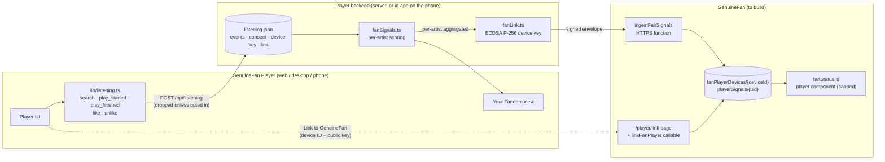

# GenuineFan Player: Fan Signals and GenuineFan integration

Status: **private experiment** on branch `genuinefan-experiment`. Not deployed, not connected to genuinefan.vip.
GenuineFan Player is inspired by [Musike](https://github.com/Ernani1234/musike) (MIT, © 2026 Ernani Neto, Ernani1234);
the original LICENSE is kept. The question this experiment answers: can a first-party player turn *how someone
listens* into fandom evidence that is harder to fake than a one-time Spotify snapshot?

## 1. Architecture



Files:

| File | What it does |
|---|---|
| `web/src/lib/listening.ts` | Player-side capture: listen sessions (heard time from position updates, seeks excluded), repeat-one, settled searches, likes |
| `web/src/player/player.ts` | Calls `listenStart / listenTick / listenSeeked / listenEnd / listenRepeat` |
| `server/src/listening.ts` | Storage (v2 log), consent, link state, sync. Shared by the server and the phone build |
| `server/src/fanSignals.ts` | Pure scoring + payload builder + canonical JSON. Unit tested in `server/test/` |
| `server/src/fanLink.ts` | WebCrypto device keys, signing and verification, link URL |
| `web/src/views/Fandom.tsx`, `components/FanSignals.tsx`, `stores/fandom.ts` | Your Fandom page, link/sync panel, Settings section |

## 2. Events (local only)

| Event | When | Fields kept |
|---|---|---|
| `search` | A search the listener settled on (no newer query for 2 s) | `query` (≤120 chars, **never synced**) |
| `play_started` | Audio actually started (not on reloads of the same track, e.g. switching to video) | track ID, artist credit, provider, `repeat` |
| `play_finished` | Track ended, was skipped/replaced, or the page closed | `listenedSec`, `durationSec`, `completion` |
| `like` / `unlike` | Favorites added/removed | track ID, artist credit, provider |

The backend sets `id` and `at` (the client can't backdate), clamps `listenedSec` to the track length, caps the log at
10,000 events, and drops everything unless `consent.recording` is on (and the operator hasn't set
`GENUINEFAN_RECORD_LISTENING=0`). Logs from the first experiment build (version 1, `play_completed` events) are
upgraded with recording **off**; their events are kept and read as full listens.

## 3. Scoring (`server/src/fanSignals.ts`, `SCORING_VERSION = 1`)

Per artist (primary artist of the credit, normalized: lowercase, accents stripped, `feat.`/`,`/`&`/`x` split off),
over the last 90 days in the listener's time zone.

- **Qualified play:** heard ≥30 s or ≥50% of the track. **Completed:** ≥90%. Skips count as plays started only.
- **Repeat:** `repeat: true` (repeat-one) or the same track started again within 30 minutes.
- **Verified vs unverified:** Spotify and Apple Music plays (the listener's own licensed subscription) count at
  full weight. `youtube-experimental` plays count at **25%** and are always reported separately.

| Component | Max | Input (verified + 0.25 × unverified) | Maxes out at |
|---|---|---|---|
| Plays | 20 | qualified plays (log scale) | 40 |
| Full listens | 20 | completed plays (log scale) | 30 |
| Catalog depth | 15 | distinct tracks with a qualified play | 12 |
| Consistency | 15 | distinct active days | 20 |
| Streak | 10 | current consecutive-day streak (ending today or yesterday) | 7 |
| Repeats | 5 | repeats | 6 |
| Saves | 10 | tracks currently in Favorites (saves outlive the window) | 4 |
| Searches | 5 | searches whose words contain the artist's name | 4 |

Then:

1. **Verification cap:** `score ≤ 40 + 60 × verifiedShare` (share of qualified plays that are verified). Unverified
   listening alone can't pass 40, so it never reaches *GenuineFan* or *VIP*.
2. **Anomaly penalties:** `implausible_volume` (>14 h of one artist in a day) ×0.5, `loop_pattern` (≥20 plays, >70%
   repeats) ×0.7, `burst` (≥15 qualified plays, ≥80% of them on one day) ×0.8.
3. **Tier** (same cut-offs as genuine-fan `fanStatus.js`): *Listener* <25, *Fan* 25+, *GenuineFan* 70+,
   *GenuineFan VIP* 85+ **and** verifiedShare ≥ 0.5 **and** no penalty flag.
4. **Badges:** verified listener (≥10 verified qualified plays), deep cuts (≥10 tracks), on repeat (≥5), 7/30-day
   streak, completionist (≥10 completed, avg ≥85%), collector (≥5 saves), seeker (≥5 searches), long haul (first and
   last play ≥30 days apart, active in the last week).

## 4. Anti-gaming

- **Unverified source.** The YouTube path can't prove anything (no account, extractable, and against YouTube's
  terms): 25% weight in the player, capped at 40, flagged `unverified_plays`, and sent under `unverified` so
  GenuineFan can score it as **zero**. Only `verified` counts should feed GenuineFan's fan score.
- **Heard time, not clicks.** Listening time is summed from playback position updates (gaps >2.5 s and seeks
  ignored), so scrubbing to the end doesn't make a completed play; the backend clamps it to the track length.
- **Diminishing returns.** Plays and completions are log-scaled; consistency and streaks need *different days*, so
  looping overnight before an on-sale buys little and trips `burst` / `implausible_volume` / `loop_pattern`.
- **Server-trusted time.** Event timestamps are set by the backend, and GenuineFan should trust only its own
  receive time plus `window`, rejecting payloads with `generatedAt` older than 10 minutes and reused nonces.
- **Signed, revocable devices.** Payloads are signed with a per-install key approved by a signed-in GenuineFan
  account. GenuineFan can rate-limit per device and per account, cap devices per account, and revoke.
- **What it can't stop:** a person (or script) running a real licensed player 24/7 on a real account. That's
  why GenuineFan should keep the player component capped and cross-check with the provider's own data (Spotify
  recently-played / top artists via the existing connection), quiz results and `userBotRisk.js`.
- **Never decisive alone.** Like the other music signals, the player component should be capped (proposal: 10 of
  the 40 music points) so the player can't become the only path to a high score.

## 5. Consent and data minimization

- **Off by default.** Nothing is recorded until the listener turns on *Record fan signals* (Your Fandom or
  Settings > Fan Signals). Sharing is a second, separate switch that needs recording **and** a linked account.
- **Local raw data.** Raw events never leave the device. Search text and track IDs are never in a payload.
- **Controls.** *Clear listening history* (Settings) deletes every event; *Unlink* deletes the device key and stops
  sharing; turning recording off also turns sharing off. *Preview what's shared* shows the exact JSON.
- **GenuineFan side (to build):** consent screen on `/player/link`, per-device revoke, delete stored aggregates on
  unlink/account deletion, privacy policy update before launch.

## 6. Sync contract (v1)

### 6.1 Link a device

1. The player creates an ECDSA P-256 key pair (WebCrypto) and a random `deviceId` (`gfp_` + 32 hex). The private
   key stays in `listening.json`.
2. *Link to GenuineFan* opens
   `{GENUINEFAN_APP_URL}/player/link?device=<deviceId>&key=<base64url SPKI>&alg=ES256&label=<text>`.
3. The page (signed in, Firebase Auth) shows what will be shared and calls a callable function:

```ts
// genuine-fan (proposed): functions/src/fanPlayer.ts
linkFanPlayer({ deviceId: string, publicKeySpki: string, alg: "ES256", label: string })
  -> { linked: true, deviceId }
// Writes fanPlayerDevices/{deviceId} = { uid, publicKeySpki, alg, label, createdAt, revokedAt: null }
// Rules: deviceId /^gfp_[0-9a-f]{32}$/, key parses as P-256 SPKI, ≤5 active devices per uid,
// a deviceId already linked to another uid is rejected.
revokeFanPlayer({ deviceId }) -> { revoked: true }   // also deletes that device's aggregates
```

4. The player stays *pending* until a sync is accepted.

### 6.2 Send summaries

`POST {GENUINEFAN_FAN_SIGNALS_ENDPOINT}` (proposed HTTPS function `ingestFanSignals`, CORS for the player origins),
body:

```json
{
  "alg": "ES256",
  "deviceId": "gfp_…",
  "payload": "<canonical JSON string of FanSignalsPayload>",
  "signature": "<base64url IEEE-P1363 r||s over UTF-8 bytes of payload>"
}
```

`payload` is canonical JSON (object keys sorted at every level, `canonicalJson()` in `fanSignals.ts`) of:

```ts
interface FanSignalsPayload {
  schema: "vip.genuinefan.player.fan-signals/v1";
  scoringVersion: 1;
  deviceId: string;            // must equal the envelope's deviceId
  nonce: string;               // UUID, single use
  generatedAt: string;         // ISO 8601
  window: { days: 90; from: "YYYY-MM-DD"; to: "YYYY-MM-DD" };
  client: { app: "genuinefan-player"; version: string; platform: string };
  artists: Array<{             // ≤50, highest player score first
    artistKey: string;         // normalized primary-artist name
    artistName: string;
    providerArtistIds: { spotify?: string; "apple-music"?: string; "youtube-experimental"?: string };
    verified: ArtistCounts;    // Spotify + Apple Music
    unverified: ArtistCounts;  // youtube-experimental: GenuineFan should score these as 0
    searches: number;
    firstSeenDay: string | null; lastSeenDay: string | null;
    avgCompletion: number;     // 0..1
    playerScore: number;       // display only; GenuineFan recomputes
    playerTier: "listener" | "fan" | "genuine" | "vip";
    flags: Array<"unverified_plays" | "implausible_volume" | "loop_pattern" | "burst">;
  }>;
}
interface ArtistCounts {
  plays: number; qualifiedPlays: number; completedPlays: number; listenedSec: number;
  distinctTracks: number; activeDays: number; streakDays: number; repeats: number; saves: number;
}
```

GenuineFan verifies, in order: body ≤64 KB; device exists and isn't revoked; `verify(ECDSA-SHA256, publicKey,
signature, payload)`; `payload.deviceId === deviceId`; schema known; `generatedAt` within 10 minutes of now; nonce
unused (store for 24 h); every count a non-negative integer with `qualifiedPlays ≤ plays`, `completedPlays ≤
qualifiedPlays`, `activeDays ≤ window.days`, `listenedSec ≤ activeDays × 86400`; rate limit (e.g. 1 accepted sync
per device per 15 minutes). Then it maps `artistKey` / `providerArtistIds` to GenuineFan artists (the existing
`resolveArtistExternalIds` and artist-name matching in `fanStatus.js`), replaces
`playerSignals/{uid}/artists/{genuineFanArtistId}` with the counts plus `receivedAt` and `deviceId`, and answers:

| Status | Body | Player does |
|---|---|---|
| 200 | `{ "linked": true, "account": "<display name or @handle>", "accepted": <n> }` | marks the link *linked* |
| 400 | `{ "error": "…" }` | shows the error |
| 401 / 403 | `{ "error": "bad signature" / "revoked" }` | back to *pending* |
| 404 | `{ "error": "unknown device" }` | stays *pending* (fan hasn't approved yet) |
| 409 | `{ "error": "replay" }` | shows the error |
| 429 | `{ "error": "too many syncs" }` | shows the error |

Reference verification in a Cloud Function (Node 22, no extra dependencies):

```ts
import { webcrypto } from "node:crypto";
const b64u = (s: string) => Buffer.from(s, "base64url");
async function verify(env: { payload: string; signature: string }, publicKeySpki: string) {
  const key = await webcrypto.subtle.importKey("spki", b64u(publicKeySpki), { name: "ECDSA", namedCurve: "P-256" }, false, ["verify"]);
  return webcrypto.subtle.verify({ name: "ECDSA", hash: "SHA-256" }, key, b64u(env.signature), new TextEncoder().encode(env.payload));
}
```

(`server/src/fanLink.ts` `verifyEnvelope` is the same check and is covered by `server/test/listening.test.ts`.)

### 6.3 Plugging into `fanStatus.js`

`calculateFanStatus` already takes per-source data (`spotifyData`, `appleMusicData`, …). Proposed addition:

```js
// genuine-fan src/utils/fanStatus.js (proposal, not implemented)
POINTS.playerVerifiedSignal = 10;   // inside maxMusic (40)
function evaluatePlayerSignals({ playerSignals }) {   // playerSignals/{uid}/artists/{artistId}
  const v = playerSignals?.verified;
  if (!v) return { points: 0, qualified: false };
  const fresh = Date.now() - toMillis(playerSignals.receivedAt) < 30 * 86400e3;
  const evidence = v.completedPlays >= 5 && v.activeDays >= 3 && !playerSignals.flags?.some(f => f !== "unverified_plays");
  return { points: fresh && evidence ? POINTS.playerVerifiedSignal : 0, qualified: fresh && evidence };
}
// qualifiedMusicServices gets "genuinefanPlayer" when qualified; unverified counts are ignored entirely.
```

`userBotRisk.js` can add a `playerSignals` input: many devices per account, `implausible_volume` / `loop_pattern` /
`burst` flags, or `verified` counts that disagree with the account's own Spotify recently-played raise risk; they
never lower it on their own.

**This repo implements the player side only.** Nothing was added to genuine-fan: its working branch had uncommitted
StubHub work, so the functions above are documented here instead. Until `ingestFanSignals` exists,
`GENUINEFAN_FAN_SIGNALS_ENDPOINT` stays unset and *Sync now* explains that nothing was sent.

## 7. Terms-of-service risk and the path to licensed playback

- The inherited playback extracts YouTube streams with yt-dlp and proxies them. That goes against
  [YouTube's Terms of Service](https://www.youtube.com/t/terms); public services that did this were shut down. The
  catalog side (youtubei.js) also uses YouTube's private InnerTube API rather than the official YouTube Data API.
- Consequences for GenuineFan: this path must never be part of genuinefan.vip, offered to GenuineFan users, or
  monetized, and its plays must never count toward fan scores. It stays as `youtube-experimental`, local only, so the
  player UI can be developed before licensed providers work.
- Licensed path: Spotify Web Playback SDK (Premium + user OAuth) and Apple MusicKit JS (developer token + music user
  token). Audio stays between the listener's own subscription and the service; the GenuineFan Player server only
  handles catalog metadata and tokens. GenuineFan already has Spotify and Apple Music integrations, so reuse those app
  registrations and token issuance instead of creating new ones.
- Other risks to manage: the YouTube path's remote stream-client config (`server/src/directAudio.ts` now fetches
  `mobile/streaming.json` from this fork, override or disable with `GENUINEFAN_STREAMING_CONFIG_URL`), and inherited
  GitHub Actions release/Docker workflows (tag triggers removed on this branch; disable Actions on the fork).
- Once licensed providers work, remove `youtube-experimental` (and yt-dlp/Deno/FFmpeg bootstrapping) from any build
  that leaves a developer's machine.

## 8. Roadmap

1. **Done on this branch:** GenuineFan branding and icons, own app IDs, provider interface, opt-in Fan Signals
   with Your Fandom, consent/clear/unlink controls, device key + signed payloads, sync client, tests.
2. **GenuineFan side:** `/player/link` page, `linkFanPlayer` / `revokeFanPlayer` callables, `ingestFanSignals`,
   Firestore rules for `fanPlayerDevices` and `playerSignals`, `fanStatus.js` player component, privacy policy.
3. **Licensed providers:** Spotify Web Playback SDK and Apple MusicKit JS playback, provider artist IDs on tracks
   (`providerArtistIds` then become the join key), default to a licensed provider, `youtube-experimental` opt-in only.
4. **Evaluation:** check whether player signals actually separate real fans from resellers/bots before giving them
   weight in production.
